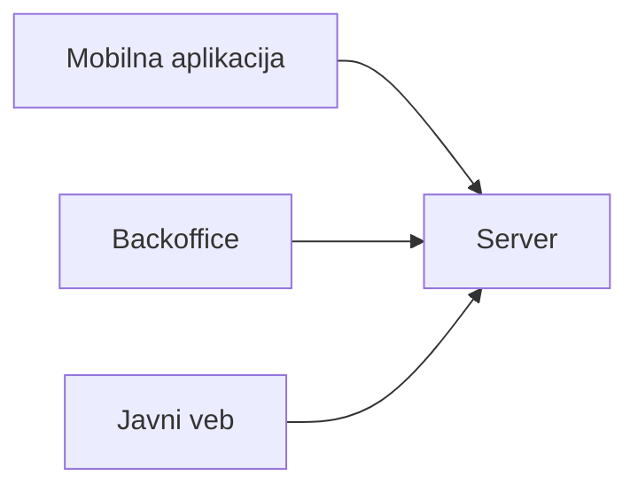

# Jobly

Informacioni sistem za omladinsku i studentsku zadrugu. Studenti preko mobilne aplikacije pretražuju privremene poslove i šalju prijave, a poslodavci i referenti zadruge u backoffice aplikaciji pregledaju kandidate i vode njihove prijave kroz stanja. Otvoreni poslovi su javno dostupni na vebu.

## Tim

| Ime i prezime | Broj indeksa | GitHub nalog |
| --- | --- | --- |
| Nikola Vasiljević | 68/24SI | [@nikola-vasiljevic04](https://github.com/nikola-vasiljevic04) |
| Vojislav Popović | 121/24SI | [@wojo16](https://github.com/wojo16) |

## Zahtevi za temu

1. **Uloge.** Sistem koriste studenti i osoblje (poslodavci i referenti zadruge), sa različitim ovlašćenjima: student šalje prijave i povlači samo svoje, a osoblje vidi sve prijave i prihvata, odbija i završava ih. Ovlašćenja su u domenu, u `AccessPolicy`.
2. **Stanja.** Glavni pojam je *prijava na posao*. Prolazi kroz pet stanja: na čekanju (poslata), prihvaćena (student je odabran), odbijena, završena (posao je odrađen i isplaćen) i povučena (student je odustao). Povlačenje menja stanje prijave, zapis se ne briše. Dozvoljeni prelazi (`canTransition`):
   * na čekanju → prihvaćena, odbijena ili povučena
   * prihvaćena → završena, odbijena ili povučena
   * odbijena, završena i povučena su krajnja stanja
3. **Pravila.** Pravila su funkcije u paketu `domain` koje vraćaju uspeh ili grešku kao tip; klijenti ih samo pozivaju i biraju tekst poruke.
   * Motivaciono pismo uz prijavu ima od 20 do 500 znakova (`MotivationLetter.parse`).
   * Student može imati najviše 5 aktivnih prijava, na čekanju ili prihvaćenih, u isto vreme (`canApply`).
   * Student se na isti oglas prijavljuje samo jednom; ponovo može tek kada povuče prijavu (`canApply`).
   * Na zatvoren oglas nije moguće prijaviti se (`canApply`).
   * Svaki oglas ima tačan broj traženih radnika. Slobodna mesta su broj traženih radnika umanjen za broj prihvaćenih i završenih prijava (`remainingSlots`); kada mesta nema, nije moguće ni prijaviti se ni prihvatiti novog kandidata. Ovo pravilo zavisi od prijava drugih studenata, pa konačnu odluku donosi server, koji odbija prijavu ako se u međuvremenu poslednje mesto popunilo.
4. **Rad bez mreže.** Student može bez internet konekcije da povuče svoju prijavu u mobilnoj aplikaciji, a izmena se šalje serveru čim se veza vrati.
5. **Posao za osoblje.** Poslodavci i referenti na velikom ekranu u tabeli i kanban prikazu uporedo pregledaju veliki broj prijava za različite oglase i masovno menjaju njihove statuse, uz rad tastaturom.
6. **Javni sadržaj.** Osnovni podaci o otvorenim poslovima (naziv pozicije, grad i satnica) prikazuju se na javnom vebu bez prijave, pa ih pronalaze i pretraživači.

## Delovi sistema

| Deo | Korisnici | Tehnologija | Platforme |
| --- | --- | --- | --- |
| Mobilna aplikacija | studenti | Flutter | Android |
| Backoffice | poslodavci, referenti | Flutter | Windows, veb |
| Javni veb | svi posetioci | KT4 | pregledač |
| Server | ostali delovi sistema | KT2 | — |
| Domenski paket | svi delovi sistema | Dart | sve |

Svi delovi koriste isti domenski paket, u kome su model i pravila. Server će čuvati podatke i ponovo proveravati svako pravilo.



## Stanje projekta

Urađena je kontrolna tačka KT1: mobilna aplikacija i backoffice rade nad istim domenom, sa lažnim podacima u memoriji. Svaki klijent ima svoje podatke i oni nisu sinhronizovani.

### Pokretanje

```bash
flutter pub get
```

U korenu repozitorijuma, a zatim u folderu aplikacije:

```bash
cd apps/mobile && flutter run
```

```bash
cd apps/backoffice && flutter run -d windows
```

```bash
cd apps/backoffice && flutter run -d chrome
```

### Paketi

| Paket | Sadržaj |
| --- | --- |
| `packages/domain` | model (oglas, prijava, korisnik), stanja i prelazi, pravila, ovlašćenja, filtriranje i sortiranje; čist Dart |
| `packages/use_cases` | portovi (`JobPostingRepository`, `ApplicationRepository`, `CandidateRepository`) i slučajevi korišćenja koji primenjuju pravila i ovlašćenja |
| `packages/blocs` | `JobsBloc`, `MyApplicationsBloc` i `ApplicationsBoardBloc`; čist Dart |
| `packages/ui` | tema, font Inter, zajednički widgeti i srpske poruke grešaka |
| `packages/design_tokens` | boje, razmaci i tipografija |

Lažne implementacije portova su u aplikacijama (`apps/*/lib/data`) i prave se u `dependencies.dart`; zamena prave implementacije ne menja ekrane ni Bloc-ove.

### Mobilna aplikacija

Aplikacija radi kao jedan prijavljeni student. Oglasi se filtriraju i sortiraju, otvaraju na posebnom ekranu (`/jobs/:id`), a prijava se šalje kroz formu sa motivacionim pismom (`/jobs/:id/apply`). U „Mojim prijavama” su sve prijave po stanjima, a na detalju prijave (`/applications/:id`) prijava se povlači uz potvrdu.

### Backoffice

Tabela i kanban sa svim prijavama, bočni panel sa detaljem, pretraga i filteri po stanju i oglasu, masovna promena statusa. Ispod 900 px širine prikazuje se lista, a izbor ostaje. Prečice: strelice ili J/K za kretanje, P prihvati, O odbij, Z završi, Space označi, Ctrl+A označi sve, Esc poništi, 1/2 tabela/kanban, Ctrl+F ili / pretraga, ? pregled prečica.

### Demo

Ikonica epruvete u gornjoj traci obe aplikacije nudi „Greška u sledećem zahtevu”, „Prazan sledeći odgovor” i „Ponovo učitaj”, za prikaz stanja učitavanja, greške sa „Pokušaj ponovo”, praznog prikaza i podataka.

### Testovi

```bash
dart format --output=none --set-exit-if-changed .
```

```bash
flutter analyze
```

U svakom paketu iz `packages` sa čistim Dartom pokreće se `dart test`, a u `packages/ui` i aplikacijama `flutter test`.
