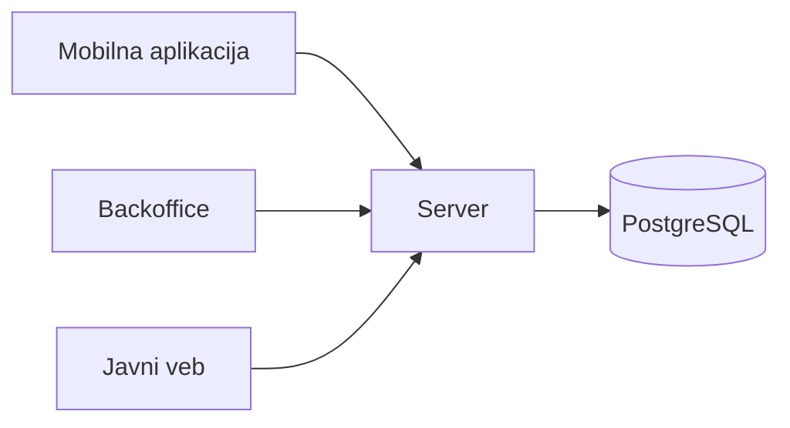

# Jobly

Informacioni sistem za omladinsku i studentsku zadrugu. Studenti preko mobilne aplikacije pretražuju privremene poslove i šalju prijave, a poslodavci i referenti zadruge u backoffice aplikaciji pregledaju kandidate i vode njihove prijave kroz stanja. Otvoreni poslovi su javno dostupni na vebu.

## Tim

| Ime i prezime | Broj indeksa | GitHub nalog |
| --- | --- | --- |
| Nikola Vasiljević | 68/24SI | [@nikola-vasiljevic04](https://github.com/nikola-vasiljevic04) |
| Vojislav Popović | 121/24SI | [@wojo16](https://github.com/wojo16) |

## Zahtevi za temu

1. **Uloge.** Sistem koriste studenti i osoblje (poslodavci i referenti zadruge), sa različitim ovlašćenjima: student šalje prijave i povlači samo svoje, a osoblje vidi sve prijave i prihvata, odbija i završava ih. Ovlašćenja su u domenu, u `AccessPolicy`.
2. **Stanja.** Glavni pojam je *prijava na posao*. Prolazi kroz pet stanja: na čekanju (poslata), prihvaćena (student je odabran), odbijena, završena (posao je odrađen i isplaćen) i povučena (student je odustao). Povlačenje menja stanje prijave, zapis se ne briše. Dozvoljeni prelazi (`canTransition`):
   * na čekanju → prihvaćena, odbijena ili povučena
   * prihvaćena → završena, odbijena ili povučena
   * odbijena, završena i povučena su krajnja stanja
3. **Pravila.** Pravila su funkcije u paketu `domain` koje vraćaju uspeh ili grešku kao tip; klijenti ih samo pozivaju i biraju tekst poruke.
   * Motivaciono pismo uz prijavu ima od 20 do 500 znakova (`MotivationLetter.parse`).
   * Student može imati najviše 5 aktivnih prijava, na čekanju ili prihvaćenih, u isto vreme (`canApply`).
   * Student se na isti oglas prijavljuje samo jednom; ponovo može tek kada povuče prijavu (`canApply`).
   * Na zatvoren oglas nije moguće prijaviti se (`canApply`).
   * Svaki oglas ima tačan broj traženih radnika. Slobodna mesta su broj traženih radnika umanjen za broj prihvaćenih i završenih prijava (`remainingSlots`); kada mesta nema, nije moguće ni prijaviti se ni prihvatiti novog kandidata. Ovo pravilo zavisi od prijava drugih studenata, pa konačnu odluku donosi server, koji odbija prijavu ako se u međuvremenu poslednje mesto popunilo.
4. **Rad bez mreže.** Student može bez internet konekcije da povuče svoju prijavu u mobilnoj aplikaciji, a izmena se šalje serveru čim se veza vrati.
5. **Posao za osoblje.** Poslodavci i referenti na velikom ekranu u tabeli i kanban prikazu uporedo pregledaju veliki broj prijava za različite oglase i masovno menjaju njihove statuse, uz rad tastaturom.
6. **Javni sadržaj.** Osnovni podaci o otvorenim poslovima (naziv pozicije, grad i satnica) prikazuju se na javnom vebu bez prijave, pa ih pronalaze i pretraživači.

## Delovi sistema

| Deo | Korisnici | Tehnologija | Platforme |
| --- | --- | --- | --- |
| Mobilna aplikacija | studenti | Flutter | Android |
| Backoffice | poslodavci, referenti | Flutter | Windows, veb |
| Javni veb | svi posetioci | KT4 | pregledač |
| Server | ostali delovi sistema | KT2 | — |
| Domenski paket | svi delovi sistema | Dart | sve |

Svi delovi koriste isti domenski paket, u kome su model i pravila. Server čuva podatke i ponovo proverava svako pravilo pre upisa.



## Stanje projekta

Urađena je kontrolna tačka KT2: mobilna aplikacija i backoffice rade nad serverom u Dartu, a server čuva podatke u PostgreSQL-u i pre svakog upisa proverava ista pravila iz domenskog paketa. Promena iz jednog klijenta vidi se u drugom posle osvežavanja.

## Pokretanje

Potrebni su Docker (Docker Desktop na Windows-u) i Flutter 3.47.6.

### Baza i server

Iz korena repozitorijuma:

```sh
cp .env.example .env    # Windows: copy .env.example .env
docker compose up -d
```

`compose.yaml` podiže tri servisa, a četvrti na zahtev:

| Servis | Šta radi | Adresa |
| --- | --- | --- |
| `db` | PostgreSQL 17 | `127.0.0.1:5436` |
| `migrate` | dbmate primeni migracije iz `apps/server/migrations`, pa izlazi | — |
| `server` | server u Dartu na Relic-u 1.2.0, slika iz `apps/server/Dockerfile` | http://localhost:8080 |
| `adminer` | baza u pregledaču, samo uz `--profile tools` | http://127.0.0.1:8082 |

Lozinka baze, `DEMO_PASSWORD`, `JWT_SECRET`, trajanje prijave (`SESSION_TTL_MINUTES`) i portovi su u `.env`, koji nije u git-u. Kada je baza prazna, server upisuje početne podatke: 12 oglasa, 45 prijava u svih pet stanja i demo naloge. Lozinke su u bazi samo kao Argon2id heš.

Provera: `docker compose ps -a` (servis `migrate` je `Exited (0)`) i `curl localhost:8080/health` (odgovor `ok`; u PowerShell-u `curl.exe`).

| Komanda | Šta radi |
| --- | --- |
| `docker compose logs server` | ispis servera; `logs migrate` za migracije |
| `docker compose up -d --build server` | nova slika servera posle izmene u `apps/server` ili u paketima |
| `docker compose stop server` | zaustavlja server, za prikaz „Nema veze sa serverom.” u aplikacijama |
| `docker compose down` | gasi sistem, podaci ostaju |
| `docker compose down -v` | gasi sistem i briše bazu; sledeći `up -d` kreće od početnih podataka |
| `docker compose --profile tools up -d adminer` | Adminer na http://127.0.0.1:8082, prijava ide sama |

Testovi servera traže pokrenutu bazu i rade nad posebnom bazom `jobly_test`: u `apps/server` pokrenuti `dart test`.

### Aplikacije

Aplikacije rade nad serverom i nalaze ga bez izmene koda: Android emulator na `10.0.2.2:8080`, desktop i pregledač na `localhost:8080`. Drugu adresu zadaje `--dart-define=SERVER_URL=http://<adresa>:8080`. Pregledač sme da zove server samo sa adrese iz `CORS_ORIGINS` u `.env`, zato se backoffice u pregledaču pokreće na portu 8081.

Svaka aplikacija u svom terminalu, iz korena repozitorijuma:

```sh
cd apps/mobile
flutter run
```

```sh
cd apps/backoffice
flutter run -d windows    # ili -d chrome --web-port 8081
```

Za `-d windows` je potreban uključen Developer Mode u podešavanjima Windows-a (`start ms-settings:developers`), zbog dodataka sa nativnim kodom.

### Demo nalozi

Lozinka za sve naloge je vrednost `DEMO_PASSWORD` iz `.env` (u `.env.example` je `jobly-demo`).

| Nalog | Uloga | Aplikacija |
| --- | --- | --- |
| `student1`, `student2` | student | mobilna |
| `referent1` | referent zadruge | backoffice |
| `poslodavac1` | poslodavac | backoffice |

`student1` ima prijave u svih pet stanja. Mobilna aplikacija prima samo studente, a backoffice samo osoblje i studentu kaže „Backoffice je za osoblje zadruge.”.

### Prijava

Prijava ostaje posle ponovnog pokretanja i osvežavanja stranice, ističe posle `SESSION_TTL_MINUTES` minuta i briše se odjavom. Kada istekne, aplikacija kaže „Prijava je istekla. Prijavite se ponovo.” i vraća na prijavu. Mobilna aplikacija čuva token u Android Keystore-u, a backoffice na Windows-u u Credential Manager-u (`flutter_secure_storage`, iza porta `TokenStore`). Backoffice u pregledaču ne čuva token: server mu postavlja httpOnly kolačić. Lozinka se na uređaju ne čuva.

Za proveru isteka: `SESSION_TTL_MINUTES=1` u `.env`, pa `docker compose up -d server`.

### Poziv mimo aplikacije

Server proverava ista pravila i prava kao klijenti i vraća isti kôd greške. Primeri za PowerShell:

```powershell
$t = (curl.exe -s -X POST localhost:8080/api/v1/sessions -H "Content-Type: application/json" -d '{\"username\":\"student1\",\"password\":\"jobly-demo\"}' | ConvertFrom-Json).token
```

```powershell
curl.exe -s -X POST localhost:8080/api/v1/applications -H "Authorization: Bearer $t" -H "Content-Type: application/json" -d '{\"jobId\":\"job-12\",\"letter\":\"Prekratko\"}'
```

Odgovor je `422` sa kodom `letter-too-short` i granicom `min: 20`, iz istog pravila kao u aplikaciji.

```powershell
curl.exe -s -X POST localhost:8080/api/v1/applications/status-changes -H "Authorization: Bearer $t" -H "Content-Type: application/json" -d '{\"ids\":[\"app-1\"],\"to\":\"accepted\"}'
```

Student ne sme da prihvata prijave: `403` sa kodom `not-allowed`. Isto važi za povlačenje tuđe prijave (`POST /api/v1/applications/<id>/withdrawal` sa tuđim `id`).

### Paketi

| Paket | Sadržaj |
| --- | --- |
| `packages/domain` | model (oglas, prijava, korisnik), stanja i prelazi, pravila, ovlašćenja (`AccessPolicy`), filtriranje i sortiranje; čist Dart |
| `packages/use_cases` | portovi (`JobPostingRepository`, `ApplicationRepository`, `CandidateRepository`, `SessionRepository`) i slučajevi korišćenja koji primenjuju pravila i ovlašćenja |
| `packages/api_contract` | zahtevi, odgovori i greške na mreži (DTO, putanje, kodovi grešaka); ne uvozi domen, Flutter ni `dart:io` |
| `packages/api_mapping` | prevod između ugovora i domena u oba smera, i za greške; koriste ga klijenti i server |
| `packages/api_client` | zajednički HTTP klijent za obe aplikacije (`ApiClient`, `HttpJobBoard`, `HttpSessionRepository`); radi na VM-u i u pregledaču |
| `packages/blocs` | `SessionBloc`, `LoginFormBloc`, `JobsBloc`, `MyApplicationsBloc` i `ApplicationsBoardBloc`; čist Dart |
| `packages/ui` | tema, font Inter, zajednički widgeti, ekran za prijavu i srpske poruke grešaka |
| `packages/design_tokens` | boje, razmaci i tipografija |

Ekrani i Bloc-ovi ne znaju odakle stižu podaci: `dependencies.dart` u svakoj aplikaciji pravi implementacije portova nad serverom (`server`) ili lažne u memoriji (`fake`, za widget testove).

### Mobilna aplikacija

Posle prijave studenta oglasi se filtriraju i sortiraju, otvaraju na posebnom ekranu (`/jobs/:id`), a prijava se šalje kroz formu sa motivacionim pismom (`/jobs/:id/apply`). U „Mojim prijavama” su sve prijave po stanjima, a na detalju prijave (`/applications/:id`) prijava se povlači uz potvrdu. Povlačenjem nadole lista se ponovo učitava sa servera. Odjava je u gornjoj traci.

### Backoffice

Tabela i kanban sa svim prijavama, bočni panel sa detaljem, pretraga i filteri po stanju i oglasu, masovna promena statusa. Ispod 900 px širine prikazuje se lista, a izbor ostaje. Prijavljeni korisnik i odjava su u traci sa strane. Prečice: strelice ili J/K za kretanje, P prihvati, O odbij, Z završi, Space označi, Ctrl+A označi sve, Esc poništi, 1/2 tabela/kanban, Ctrl+F ili / pretraga, R osveži sa servera, ? pregled prečica.

### Odluke za KT2

* **Pravilo koje zavisi od drugih korisnika:** ograničen broj mesta na oglasu (`remainingSlots`). Konačno ga čuva server: prihvatanje radi u transakciji koja zaključava red oglasa (`SELECT ... FOR UPDATE`), pa od dva istovremena prihvatanja poslednjeg mesta prolazi samo jedno. Pravilo „jedna prijava po oglasu, osim povučenih” dodatno čuva delimični jedinstveni indeks u bazi.
* **Zakasneli klijent:** dobija grešku `no-slots-left` (ili `invalid-transition` ako je prijavu u međuvremenu promenio neko drugi), vidi istu poruku kao kada pravilo proveri sam klijent i ponovo učitava podatke.
* **Vidljivost:** student vidi oglase i samo svoje prijave, osoblje vidi sve prijave sa podacima kandidata.
* **Na mreži:** satnica je ceo broj dinara, vreme je trenutak u ISO 8601 (UTC), stanja su engleske reči (`pending`, `accepted`...).
* **Tuđa promena:** klijent je vidi posle osvežavanja (povlačenje nadole u mobilnoj, R ili dugme „Osveži” u backoffice-u).
* **Pregledač:** CORS dozvoljava samo adresu backoffice-a, a sesija u pregledaču ide kroz httpOnly kolačić umesto tokena u skladištu.
* **Spoljni servis:** obaveštenja kandidatima šalje samo server, iza porta `NotificationSender`; za KT2 je implementacija koja samo ispisuje u log.

### Testovi

```bash
dart format --output=none --set-exit-if-changed .
```

```bash
flutter analyze
```

U svakom paketu iz `packages` sa čistim Dartom pokreće se `dart test`, a u `packages/ui` i aplikacijama `flutter test`. Testovi servera (`apps/server`, `dart test`) traže pokrenutu bazu.
